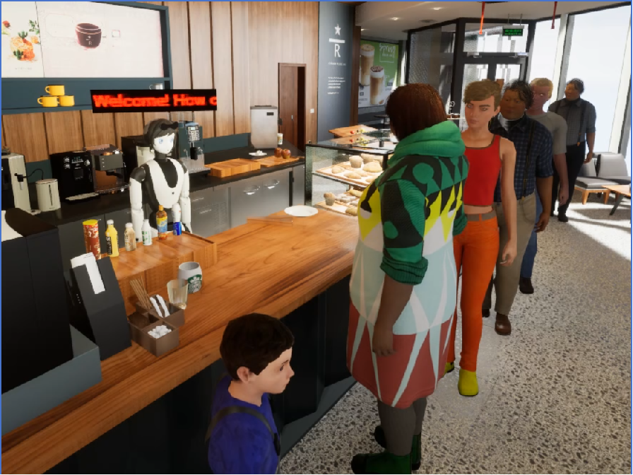
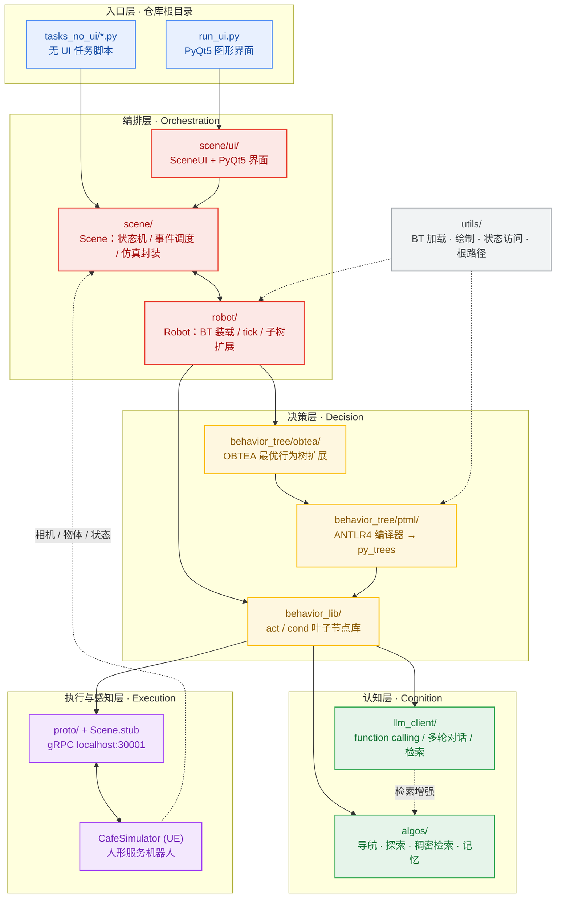
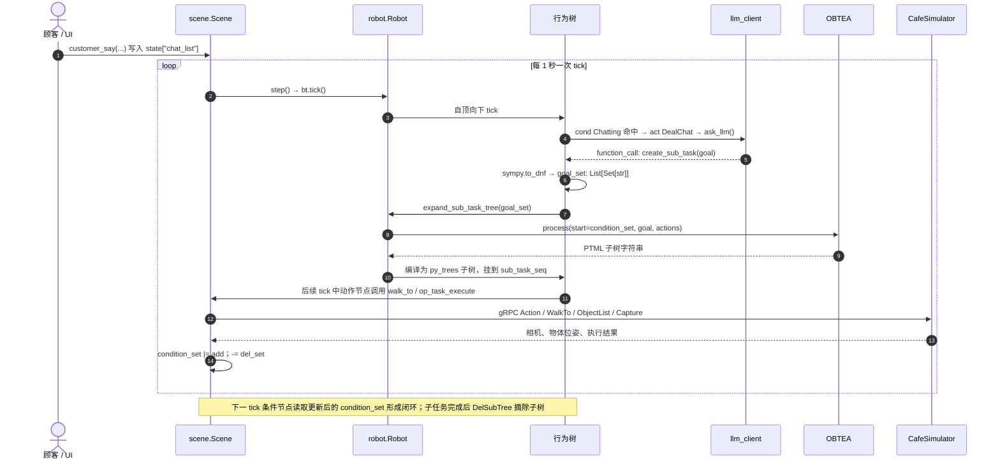
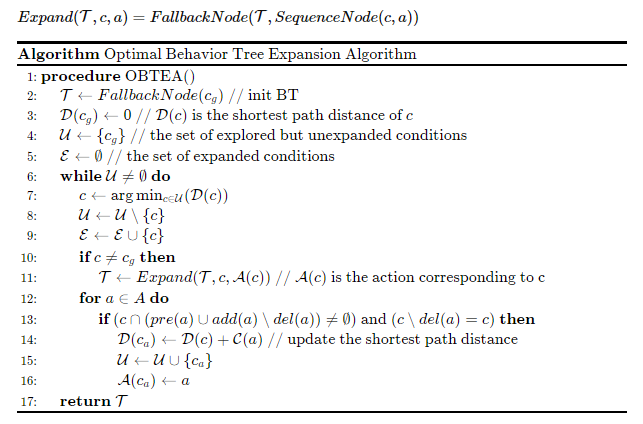
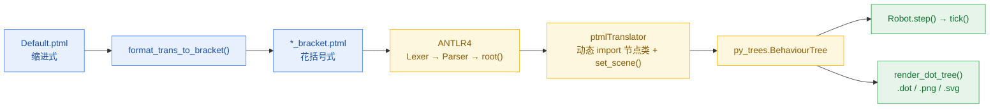
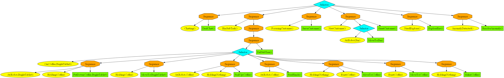
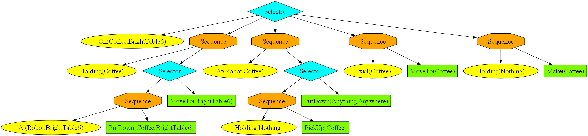

<div align="center">



# `robowaiter/` · 具身智能体核心包

**自然语言指令 → 符号目标 → 最优行为树 → 仿真执行**

[](https://www.python.org/)
[](https://py-trees.readthedocs.io/)
[](https://www.antlr.org/)
[](https://grpc.io/)
[](https://www.riverbankcomputing.com/)
[](https://arxiv.org/abs/2405.07474)
[](../LICENSE)

</div>

> [!NOTE]
> 本文只讲 `robowaiter/` 这一个 Python 包的**内部架构**。系统介绍、安装步骤、仿真器下载与全部论文列表见 [仓库根 README](../README.md)。

**阅读路线**：本文件按「**先总再分**」组织——先用一章看清全局分层与端到端数据流，再逐层拆解每个子包，最后深入核心机制、上手方式与工程现状。

| | 章节 | 你会得到什么 |
|:--:|---|---|
| **总** | [一、总览](#sec1) | 定位、三条设计原则、分层架构图、一次任务全链路、目录地图 |
| **分** | [二、逐层拆解](#sec2) | 8 个子包各自的职责、关键文件与设计要点 |
| **深** | [三、核心机制](#sec3) | 符号世界模型、PTML 编译、行为树动态扩展、OBTEA 输入输出 |
| **用** | [四、技术栈](#sec4) · [五、上手与扩展](#sec5) | 依赖清单、启动方式、加节点 / 加任务的套路 |
| **实** | [六、现状与注意事项](#sec6) · [七、与论文的关系](#sec7) | 运行前置条件、历史遗留、与上层项目的对应 |

---

<a id="sec1"></a>

## 一、总览

### 1.1 一句话定位

`robowaiter/` 是咖啡厅服务机器人的**运行时内核**：它把一句自然语言点单，经 LLM 转成符号化目标，由最优行为树扩展算法编译成一棵可执行行为树，再通过 gRPC 驱动 UE 仿真器中的机器人完成动作，并用一份符号状态把「规划」与「执行」闭环起来。

### 1.2 三条设计原则

| 原则 | 具体做法 | 解决什么 |
|---|---|---|
| **LLM 只出目标，不出动作序列** | LLM 输出一阶逻辑形式的目标状态（如 `On(Coffee,Table1)`），动作序列完全交给 OBTEA 规划 | 缓解具身幻觉，让 LLM 的开放域语义能力不破坏执行的可靠性 |
| **行为树是系统中枢** | 所有感知、决策、动作都是 BT 节点；顶层树静态装载，子任务树运行时动态插入 | 模块化、可解释、反应式；树可被绘制、被检查、被热替换 |
| **单一符号世界模型** | `Scene.state["condition_set"]` 既是条件节点的判定依据，也是规划器的初始状态与动作模型 | 规划与执行共用同一套谓词，避免「规划一套、执行另一套」 |

### 1.3 分层架构图



> 依赖方向自上而下；`behavior_lib` 的节点**不 import** `scene`，而是在编译期由 `set_scene()` 注入场景引用，属于回调式耦合，因此节点库可以独立替换。

### 1.4 一次任务的完整链路



关键点：**LLM 不产生动作，动作由 OBTEA 依据 `condition_set` 与动作的 `pre / add / del_set / cost` 自动生成**；视觉感知主要用于障碍点、语义地图与界面显示，并不逐个 tick 全量刷新符号状态。

### 1.5 目录地图

```text
robowaiter/
├── __init__.py                 # 仅导出 Robot
│
├── scene/                      # 编排 + 执行：场景基类、仿真封装、UI、可视化产物
│   ├── scene.py                #   class Scene：状态机 / gRPC / 100+ 场景操作方法
│   ├── ui/                     #   SceneUI、PyQt5 主界面、window.ui、Tkinter 轻量界面
│   └── outputs/                #   运行时生成的 current_bt / expanded_bt 的 .dot .png .svg
│
├── robot/                      # 编排：BT 生命周期
│   ├── robot.py                #   class Robot：load_BT / expand_sub_task_tree / step
│   ├── Default.ptml            #   默认顶层行为树（缩进式）
│   └── DefaultNLP.ptml         #   对话版行为树（历史变体）
│
├── behavior_lib/               # 决策：可直接写进 PTML 的节点库
│   ├── _base/                  #   Bahavior / Act / Cond / Sequence / Selector / Inverter
│   ├── act/                    #   动作节点：MoveTo Make PickUp PutDown Clean Turn DealChat ...
│   ├── cond/                   #   条件节点：On Holding RobotNear IsClean Chatting ...
│   └── other/                  #   旧命名节点，不参与自动加载
│
├── behavior_tree/              # 决策：从「目标」到「树」
│   ├── ptml/                   #   ptml.g4 + ANTLR 生成物 + ptmlCompiler / ptmlTranslator
│   ├── obtea/                  #   OptimalBTExpansionAlgorithm.py / opt_bt_exp_main.py
│   └── dataset/ dataset1224/   #   目标状态集合与句式扩写脚本
│
├── llm_client/                 # 认知：LLM 接入、工具调用、检索、评测数据
│   ├── tool_register.py        #   register_tool / get_tools / dispatch_tool
│   ├── multi_rounds.py         #   主对话入口 ask_llm
│   ├── single_round.py         #   单轮请求（改 API 地址在这里）
│   ├── passage_retrieval3.py   #   Contriever + faiss 检索流水线
│   └── data/ test_llm/         #   问答字典、jsonl 数据与评测输出
│
├── algos/                      # 认知：可插拔的算法集合
│   ├── navigator/              #   D* Lite 栅格导航
│   ├── explore/                #   主动探索 / frontier / 语义地图
│   ├── retrieval/              #   Contriever 模型与 faiss 索引
│   ├── MemGPT_simple/          #   分层记忆智能体原型
│   └── vision/                 #   预留（当前为空文件）
│
├── proto/                      # 执行：GrabSim gRPC 协议与场景字典
│   ├── __init__.py             #   导出 GrabSim_pb2 / GrabSim_pb2_grpc
│   ├── camera.py               #   彩色 / 深度 / 分割相机、障碍点与语义地图
│   ├── semantic_map.py         #   Init / SetWorld / Observe / Reset 示例
│   └── objs.json map_1.pkl ui.qrc   # 物体字典、预置地图、Qt 资源
│
└── utils/                      # 基础设施
    ├── basic.py                #   get_root_path()
    ├── bt/load.py              #   load_bt_from_ptml / load_behavior_tree_lib
    ├── bt/draw.py              #   dot_tree / render_dot_tree
    ├── bt/visitor.py           #   StatusVisitor
    └── draw_bt/                #   独立绘图脚本与示例 PTML
```

---

<a id="sec2"></a>

## 二、逐层拆解

### 2.1 编排层 · `scene/` + `robot/` + 入口

场景是运行时宿主，机器人是行为树的持有者，两者通过 `set_scene()` 双向引用。

| 文件 | 角色 | 关键成员 |
|---|---|---|
| [`scene/scene.py`](scene/scene.py) | 场景基类、状态机、仿真 RPC 封装 | `default_state`、`__init__`、`init_robot`、`reset`、`run`、`step`、`customer_say`、`new_set_goal`、`walk_to`、`op_task_execute`、`get_obstacle_point` |
| [`scene/ui/scene_ui.py`](scene/ui/scene_ui.py) | UI 场景，覆写绘图与各任务入口 | `run_AEM` / `run_GQA` / `run_VLN` / `run_VLM` / `run_OT` / `run_AT` / `run_CafeDaily` |
| [`scene/ui/pyqt5.py`](scene/ui/pyqt5.py) | PyQt5 主界面与后台线程 | `UI`、`TaskThread`、`run_scene`；与场景通过两个 `queue.Queue` 双向通信 |
| [`robot/robot.py`](robot/robot.py) | BT 生命周期 | `load_BT`、`expand_sub_task_tree`、`collect_action_nodes`、`step` |
| [`../run_ui.py`](../run_ui.py) / [`../tasks_no_ui/`](../tasks_no_ui/) | 两个外部入口 | UI 入口传 `Robot` 类；无 UI 脚本统一是 `Scene` 子类 + `reset()` + `run()` |

<p align="center">
  
  <br/><sub>图 1 · PyQt5 界面：左侧任务按钮，右上输入目标或自然语言，中部实时显示行为树与语义地图</sub>
</p>

**任务是怎么定义的**：继承 `Scene` 并重写 `_reset / _run / _step`，再在 `__init__` 里填三组事件列表——`event_list`（绝对时刻）、`new_event_list`（时刻 + 函数 + 参数）、`signal_event_list`（相对时刻，`t < 0` 表示等机器人停下）。`Scene.step()` 每帧分发事件、调用 `_step()`，最后执行 `robot.step()`。

### 2.2 决策层 A · `behavior_lib/` — 节点库

所有叶子节点继承 [`_base/Behavior.py`](behavior_lib/_base/Behavior.py) 的 `Bahavior`（`py_trees.behaviour.Behaviour` 子类），由 `Act` / `Cond` 分出动作与条件两类；`Sequence` / `Selector`（即 Fallback）/ `Inverter` 封装组合与装饰节点。

| 类别 | 代表节点 | 与场景的交互 |
|---|---|---|
| 动作 `act/` | `MoveTo`、`Make`、`PickUp`、`PutDown`、`Clean`、`Turn`、`GreetCustomer`、`ServeCustomer`、`DealChat`、`ExploreEnv`、`SubTaskPlaceHolder`、`DelSubTree` | `_update()` 调用 `scene.walk_to()` / `op_task_execute()` / `move_to_obj()` 等仿真封装，成功后按 `add` / `del_set` 更新 `condition_set` |
| 条件 `cond/` | `On`、`Holding`、`RobotNear`、`IsClean`、`Active`、`Closed`、`Low`、`Exists`、`Chatting`、`HasSubTask`、`NeedExplore` | 多为 `if self.name in scene.state["condition_set"]` → `SUCCESS` / `FAILURE`；`Chatting` 额外检查 `chat_list` 与 `attention` |

**一个节点同时是「执行体」和「规划模型」**——这是本包最值得注意的设计。`Act.get_info()` 返回的 `pre / add / del_set / cost` 既被 `_update()` 用来推进状态，又被 `Robot.collect_action_nodes()` 展开成 OBTEA 所需的 `Action` 对象：

```python
# behavior_lib/act/MoveTo.py
    @classmethod
    def get_info(cls,arg):
        info = {}
        info['pre'] = set()
        if arg in Act.all_object:
            info['pre'] |= {f'Exists({arg})'}
        info["add"] = {f'RobotNear({arg})'}
        info["add"] |= {f'Not RobotNear({place})' for place in cls.valid_args if place != arg}
        info["del_set"] = {f'RobotNear({place})' for place in cls.valid_args if place != arg}
        info["del_set"] |= {f'Not RobotNear({arg})'}
        info['cost'] = 10
        return info
```

`can_be_expanded = True` 与 `valid_args` 决定该节点能否被规划器实例化、以及能枚举出哪些参数。`_base/Behavior.py` 里还集中放置了物体词表、可放置桌面、地点坐标 `place_xy_yaw_dic` 等常量。

### 2.3 决策层 B · `behavior_tree/` — 编译器 + 规划器

| 子目录 | 职责 | 关键文件 |
|---|---|---|
| `ptml/` | 自定义行为树 DSL 的词法/语法/编译 | [`ptml.g4`](behavior_tree/ptml/ptml.g4)、[`ptmlCompiler.py`](behavior_tree/ptml/ptmlCompiler.py)（`load()`、`format_trans_to_bracket()`）、[`ptmlTranslator.py`](behavior_tree/ptml/ptmlTranslator.py) |
| `obtea/` | **最优行为树扩展算法**（论文 Stage 2） | [`OptimalBTExpansionAlgorithm.py`](behavior_tree/obtea/OptimalBTExpansionAlgorithm.py)（`OptBTExpAlgorithm.run_algorithm()`、`get_ptml()`）、[`opt_bt_exp_main.py`](behavior_tree/obtea/opt_bt_exp_main.py)（`BTOptExpInterface.process()`）、`BTExpansionAlgorithm.py`（非最优对照） |
| `dataset/` `dataset1224/` | 目标状态集合生成、句式扩写与相似度匹配 | `goal_states_generation.py`、`sentence_expansion.py` |

<p align="center">
  
  <br/><sub>图 2 · OBTEA 伪代码：以目标条件为起点做类 Dijkstra 的反向条件空间搜索，逐轮扩展 Fallback 子树</sub>
</p>

算法内部有自己的轻量树表示 [`obtea/BehaviorTree.py`](behavior_tree/obtea/BehaviorTree.py)（`Leaf` / `ControlBT`，`tick(state)` 用于可达性验证），与运行时的 `py_trees` 树是两套东西：**前者产出 PTML 文本，后者消费 PTML 文本**。`obtea/` 下的 `*_new.py` / `*_old.py` / `*_other.py` 与 `examples.py` / `tools.py` 是算法迭代与实验存档，主链只用上表两个文件。

### 2.4 认知层 A · `llm_client/` — 大模型接入

LLM 侧不生成动作，只做两件事：**把指令翻译成目标公式**、**回答关于场景的问询**。

| 文件 | 职责 |
|---|---|
| [`tool_register.py`](llm_client/tool_register.py) | 用 `typing.Annotated` 反射生成 OpenAI `functions` schema；注册 `create_sub_task(goal)`、`get_object_info`、`get_number_of_objects`、`stop_serve` |
| [`multi_rounds.py`](llm_client/multi_rounds.py) | 主对话入口 `ask_llm()`，`new_history(maxlen=7)`、`get_response()`、`deal_response()` 解析 `function_call`；`multi_rounds_retri.py` 是检索增强变体 |
| [`tool_api.py`](llm_client/tool_api.py) / `ask_llm.py` | 一次请求 + 工具调用循环，返回 `{"Answer", "Goal"}`；`ask_llm.py` 先查固定问答字典再回退到模型 |
| [`single_round.py`](llm_client/single_round.py) | 单轮改写 / 翻译 / 直接问答，**API 地址在这里配置** |
| [`passage_retrieval3.py`](llm_client/passage_retrieval3.py) | Contriever 编码 → faiss 建索引 → top-k 检索，供检索增强对话使用 |
| `data/` `data_tools/` `test_llm/` | 固定问答字典、`train_robot.jsonl` 检索语料、CSV ↔ JSONL 转换工具、评测输出 |

`behavior_lib/act/DealChat.py` 是这一层与决策层的接缝：它调用 `ask_llm()`，把返回的 goal 经 `sympy.to_dnf` 解析为 `List[Set[str]]`，再触发 `robot.expand_sub_task_tree()`。

### 2.5 认知层 B · `algos/` — 可插拔算法集合

| 子包 | 一句话 | 主类 / 函数 |
|---|---|---|
| [`navigator/`](algos/navigator/) | 基于 D* Lite 的栅格路径规划，配合 `costMap_*.pkl` 代价地图 | `Navigator.navigate()`、`DStarLite.planning()` |
| [`explore/`](algos/explore/) | 主动探索：frontier 检测、最近前沿选择、语义地图构建 | `explore()`、`isNewFrontier()`、`getNearestFrontier()` |
| [`retrieval/`](algos/retrieval/) | Contriever + `faiss.IndexFlatIP/IndexPQ` 的稠密检索流水线 | `Indexer`、`Retrieval.get_result()` |
| [`MemGPT_simple/`](algos/MemGPT_simple/) | 分层记忆（核心 / 归档 / 回忆）智能体原型，独立命令行程序 | `Agent`、`CoreMemory`、`ArchivalMemory` |
| [`vision/`](algos/vision/) | 预留目录 | 当前 `vision.py` 为空文件 |

这一层通过 `Scene.init_algos()` 与 `llm_client/multi_rounds_retri.py` 接入主链，各子包之间基本互不依赖，可单独替换。

### 2.6 执行与协议层 · `proto/` + 仿真器

通信方式是 **gRPC 而非裸 socket**：`Scene.__init__()` 建立 `grpc.insecure_channel("localhost:30001")`，构造 `GrabSimStub`，随后所有 `SetWorld` / `Observe` / `Action(WalkTo)` / `ObjectList` / `Capture(CameraList)` / `ControlRobot` 调用都经由它发往 CafeSimulator。HTTP 只出现在 LLM 侧。

| 文件 | 作用 |
|---|---|
| [`proto/__init__.py`](proto/__init__.py) | 导出 `GrabSim_pb2` / `GrabSim_pb2_grpc` |
| [`proto/camera.py`](proto/camera.py) · [`semantic_map.py`](proto/semantic_map.py) | 彩色 / 深度 / 分割相机、`get_obstacle_point()`、`get_semantic_map()`、`transform_co()`，自带同端口 stub 示例 |
| `proto/objs.json` · `map_1.pkl` | 物体 ID → 名称 / 坐标 / 高度字典、预置栅格地图 |

> [!IMPORTANT]
> 仓库内**没有** `*.proto`、`GrabSim_pb2.py`、`GrabSim_pb2_grpc.py`，它们由 CafeSimulator 发行包提供。运行前需先启动仿真器并准备好协议生成代码，否则 `Scene` 无法初始化。

### 2.7 基础设施 · `utils/`

| 文件 | 作用 |
|---|---|
| [`basic.py`](utils/basic.py) | `get_root_path()`，全包路径基准 |
| [`bt/load.py`](utils/bt/load.py) | `load_bt_from_ptml()`（编译 + 包成 `py_trees.BehaviourTree`）、`load_behavior_tree_lib()`（动态导入 `act/` `cond/` 全部类）、`find_node_by_name()` |
| [`bt/draw.py`](utils/bt/draw.py) | `dot_tree()` / `render_dot_tree()`，用 pydot 输出 `.dot` / `.png` / `.svg` |
| [`bt/visitor.py`](utils/bt/visitor.py) | `StatusVisitor` 收集每次 tick 的节点状态文本，驱动 `Scene.robot_changed` |
| [`draw_bt/`](utils/draw_bt/) | 不启动仿真、只加载 PTML 绘图的独立脚本 |

---

<a id="sec3"></a>

## 三、核心机制

### 3.1 符号世界模型 `condition_set`

`Scene.state` 是一个字典，`condition_set` 是其中最重要的字段：一组谓词字符串，如 `{"RobotNear(Bar)", "Exists(Coffee)", "On(Coffee,Table1)"}`。它同时服务三个角色：

1. **条件节点的判定依据**——`Cond._update()` 检查 `self.name in condition_set`；
2. **规划器的初始状态**——`BTOptExpInterface.process()` 以它作为 `start`；
3. **动作执行的产物**——每个 `Act._update()` 末尾执行 `|= info["add"]`、`-= info["del_set"]`。

因此「规划 → 执行 → 状态更新 → 下一 tick 条件判定」是一个自洽闭环，无需让规划器直接接触仿真器。

### 3.2 PTML：行为树的「源代码」

PTML 是本包自定义的 DSL，语法见 [`behavior_tree/ptml/ptml.g4`](behavior_tree/ptml/ptml.g4)：内部节点为 `sequence` / `selector` / `parallel N`，叶子为 `act` / `cond` 加可选 `Not` 前缀，参数支持整数、浮点、布尔与字符串。

它支持**两种写法**：

```text
# 缩进式 · robot/Default.ptml（手写，可读性好）
selector
    sequence
        cond Chatting()
        act DealChat()
    sequence
        cond HasSubTask()
        sequence
            act SubTaskPlaceHolder()
```

```text
# 花括号式 · ptml/test/CoffeeDelivery.ptml（ANTLR 实际消费的形式）
sequence{
    selector{
        cond CoffeeCupFound()
        act FindCoffeeCup()
        sequence{
            cond SeqTest()
            act Move(1.2, 2, 2.3, True)
            parallel 3 { cond Isact() act Testact() }
        }
    }
}
```



`ptmlTranslator` 用 `exec`/`eval` 按名字动态实例化节点类，所以**往 `act/` 或 `cond/` 丢一个新文件，PTML 里立刻就能写它**，不需要注册中心。注意 `load_behavior_tree_lib()` 只扫描 `act/` 与 `cond/`，`other/` 下的旧节点不参与自动加载。

### 3.3 默认行为树与动态扩展

<p align="center">
  
  <br/><sub>图 3 · 默认顶层行为树：根节点是 Selector（Fallback），依次处理「对话 → 子任务 → 服务顾客 → 迎宾 → 探索 → 异常」</sub>
</p>

顶层树是静态的 `Default.ptml`，其中 `SubTaskPlaceHolder()` 是一个占位符。`Robot.load_BT()` 找到它后把父 Sequence 记为 `scene.sub_task_seq`。当 LLM 给出新目标时，`Robot.expand_sub_task_tree()` 会：

1. `collect_action_nodes()` 把节点库展开成 `List[Action]`；
2. 调 `BTOptExpInterface.process(goal)` 得到 PTML 子树，写入 `./sub_task.ptml`；
3. 重新编译成 `py_trees` 子树，与 `DelSubTree` 一起挂到 `sub_task_seq`；
4. 渲染 `scene/outputs/expanded_bt.png` 并刷新界面。

<p align="center">
  
  <br/><sub>图 4 · 插入子任务后的行为树：中部密集的「条件 + 动作」分支即 OBTEA 生成的最优子树</sub>
</p>

子任务完成后 `DelSubTree._update()` 把该子树从 `sub_task_seq.children` 摘除，顶层树恢复原状——这就是「任务可组合、树可热插拔」的实现方式。

### 3.4 OBTEA 的输入与输出

| | 内容 | 来源 |
|---|---|---|
| 输入 `start` | 当前符号状态 `Set[str]` | `scene.state["condition_set"]` |
| 输入 `goal` | DNF 目标 `List[Set[str]]`，每个集合是一个子目标 | `DealChat.create_sub_task()` → `sympy.to_dnf` |
| 输入 `actions` | `Action(name, pre, add, del_set, cost)` 列表 | `Robot.collect_action_nodes()` ← 各 `Act.get_info()` |
| 输出 | `selector{ ... }` 形式的 PTML 字符串 | `OptBTExpAlgorithm.get_ptml()` → `sub_task.ptml` |

算法从目标条件反向搜索：每轮取当前代价最小的条件 $c$，对每个可到达它的动作 $a$ 生成前驱条件 $c_a = pre(a) \cup c \setminus add(a)$，松弛 $D(c_a) = D(c) + D(a)$，并把 `Sequence(c_a, a)` 挂到 Fallback 下；一旦扩展到 $c \subseteq s_0$ 即停止。最后按子树总代价升序装配到同一个 Fallback 下，保证优先走最低代价路径。`merge_subtree()` 对应论文中的 Compaction：抽取相邻条件的公共文字以减少运行时条件节点 tick。

### 3.5 为什么这样切分

| 若让 LLM 直接输出动作序列 / 整棵 BT | 本框架的做法 |
|---|---|
| 需要大量「指令-BT」标注做微调 | 预训练 LLM + few-shot + function calling，零微调 |
| 无法保证计划可达、代价最优 | OBTEA 给出有限时间成功与最小代价保证 |
| 生成的树难以调试、难以复用 | PTML 是文本、可编译、可绘制、子树可插拔 |

---

<a id="sec4"></a>

## 四、技术栈

| 层次 | 依赖 |
|---|---|
| 行为树 | `py_trees 2.6`、`pydot`、`shortuuid`、`antlr4-python3-runtime 4.13`、`sympy`（`to_dnf`）、Graphviz（系统级 `dot`） |
| LLM / 语义 | OpenAI 兼容 HTTP 接口、`requests`、`spacy`（中英文模型）、`translate`、`openai`、`loguru` |
| 仿真通信 | `grpcio` / `grpcio-tools` / `protobuf 3.20`（`GrabSim` 服务，`localhost:30001`） |
| 检索 / ML | `faiss`（需 conda 安装）、`torch`、`transformers` + Contriever、`scikit-learn`（DBSCAN）、`numpy`、`scipy` |
| 界面 / 可视化 | `PyQt5 5.15`（主界面 + Qt Designer `.ui`）、Tkinter（轻量界面）、`matplotlib`、`Pillow` |
| 工程 | Python ≥ 3.10，`setuptools`（`pip install -e .`），依赖锁定于 [`../requirements.txt`](../requirements.txt) |

---

<a id="sec5"></a>

## 五、上手与扩展

### 5.1 三种运行方式

以下命令均在**仓库根目录**执行；前两种方式需先启动 CafeSimulator：

```bash
# 1. 无 UI：跑一个具体任务场景
python tasks_no_ui/Demo/Easy.py

# 2. 图形界面：左侧按钮触发任务，右上角输入自然语言
python run_ui.py

# 3. 只调 LLM 客户端做命令行对话（不启仿真）
cd robowaiter/llm_client && python multi_rounds.py
```

### 5.2 新增一个动作节点

1. 在 [`behavior_lib/act/`](behavior_lib/act/) 新建与类名同名的 `.py`，继承 `Act`；
2. 声明 `can_be_expanded = True`、`num_args`、`valid_args`（决定规划器能枚举哪些参数），实现 `@classmethod get_info()` 返回 `pre / add / del_set / cost`；
3. 实现 `_update()`：调用 `self.scene` 的仿真封装，末尾按 `info` 更新 `condition_set`，返回 `py_trees.common.Status`。

参照 [`behavior_lib/act/MoveTo.py`](behavior_lib/act/MoveTo.py) 即可，`utils/bt/load.py` 会自动发现它，无需注册。条件节点同理，放在 `cond/` 下并检查 `condition_set`。

### 5.3 新增一个任务场景

标准模板（摘自 `tasks_no_ui/Demo/Easy.py`）：

```python
from robowaiter.scene.scene import Scene

class SceneOT(Scene):
    def __init__(self, robot):
        super().__init__(robot)
        self.signal_event_list = [
            (3, self.add_walker, (3, 0, 700)),
            (1, self.customer_say, (0, "Could you please lower the AC temperature?")),
        ]

    def _reset(self):
        self.gen_obj_tmp()

    def _run(self):
        pass

if __name__ == '__main__':
    from robowaiter.robot.robot import Robot
    task = SceneOT(Robot())
    task.reset()
    task.run()
```

`customer_say()` 把指令压入 `state["chat_list"]`，之后的一切（LLM 解析、目标生成、BT 扩展、执行）由框架自动完成。

### 5.4 更换 LLM 服务

LLM endpoint 目前硬编码在 [`llm_client/single_round.py`](llm_client/single_round.py)、[`multi_rounds.py`](llm_client/multi_rounds.py)、[`tool_api.py`](llm_client/tool_api.py)。改成任意 OpenAI 兼容的本地 / 在线服务即可；工具调用链路要求模型支持 `functions` / `function_call`。需要检索增强时，改用 `multi_rounds_retri.py` 并准备 faiss 索引与 Contriever 权重。

### 5.5 可视化产物在哪

| 文件 | 产生时机 |
|---|---|
| `scene/outputs/current_bt.{dot,png,svg}` | `SceneUI.draw_current_bt()`，每次树结构变化 |
| `scene/outputs/expanded_bt.{dot,png,svg}` | `Robot.expand_sub_task_tree()` 插入子任务树后 |
| `robot/*_bracket.ptml` | `format_trans_to_bracket()` 编译缩进式 PTML 时 |
| 根目录 `sub_task.ptml` | OBTEA 每次扩展的最新子树 |

---

<a id="sec6"></a>

## 六、现状与注意事项

> [!TIP]
> 本包是比赛原型 + 论文系统实现的结合体，主链清晰，但保留了较多实验存档。下表是阅读和复现时容易踩的点。

| 事项 | 说明 |
|---|---|
| 协议生成代码不在仓库 | `GrabSim_pb2.py` / `GrabSim_pb2_grpc.py` / `*.proto` 均未提供，需由 CafeSimulator 发行包补齐 |
| LLM 地址硬编码 | 三处 `llm_client/*.py`，无 `.env` 配置 |
| faiss 与模型权重 | `faiss` 未写入 `requirements.txt`，需 `conda install -c conda-forge faiss`；`algos/retrieval/contriever-msmarco/` 只有 tokenizer / config，无权重 |
| `algos/vision/vision.py` | 0 字节空文件，视觉算法未随包提供 |
| `DefaultNLP.ptml` | 引用的 `CustomerChatting` / `DealChatNLP` 等节点类在主节点库中未找到，属历史变体；主链使用 `Default.ptml` |
| 存档目录 | `behavior_lib/other/`、`behavior_tree/dataset*/`、`obtea/*_new/_old/_other.py`、`scene/ui/ui.py`（Tkinter）、仓库根 `BTExpansionCode/` 与 `LLM_Evaluation_Kit/` 均不参与主链 |
| 仓库根 `window.py` | 仅是 `pyuic5` 生成的注释头，真正界面类在 `scene/ui/window.py` |
| `scene/__init__.py` 的 `task_map` | 已被注释；`ptml/ptml_test.py` 仍引用它，属遗留代码 |

---

<a id="sec7"></a>

## 七、与论文和上层项目的关系

本包是 IJCAI 2024 论文 **《Integrating Intent Understanding and Optimal Behavior Planning for Behavior Tree Generation from Human Instructions》**（[arXiv:2405.07474](https://arxiv.org/abs/2405.07474)）的系统实现：

| 论文中的概念 | 本包中的位置 |
|---|---|
| Stage 1 · Intent Understanding | `llm_client/` + `behavior_lib/act/DealChat.py`（`sympy.to_dnf` 归一化） |
| WFF / DNF 目标 | `goal_set: List[Set[str]]`，`condition_set` |
| Stage 2 · OBTEA | `behavior_tree/obtea/` → PTML → `robot/robot.py` 动态挂载 |
| 行为树执行与咖啡厅部署 | `py_trees` + `scene/` + `proto/` gRPC + CafeSimulator |

仓库根的 `LLM_Evaluation_Kit/`（论文 Table 1 实验快照）与 `BTExpansionCode/`（算法实验存档）是**复现资料**，与本包没有 import 关系。后续的 MRBTP、HBTP、Diff-BT 等研究脉络见 [根 README](../README.md)。

---

<div align="center">

`robowaiter/` · NUDT-HPCL-EI · MIT License

[返回仓库根 README](../README.md)

</div>
