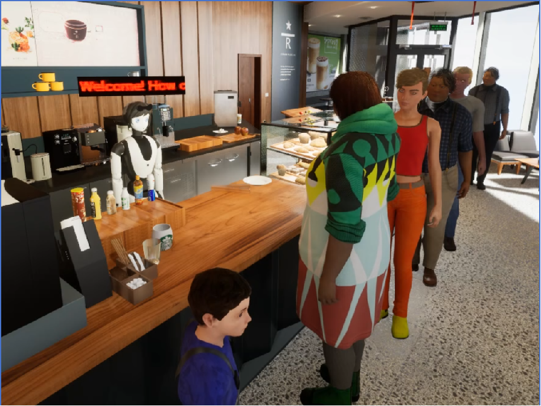
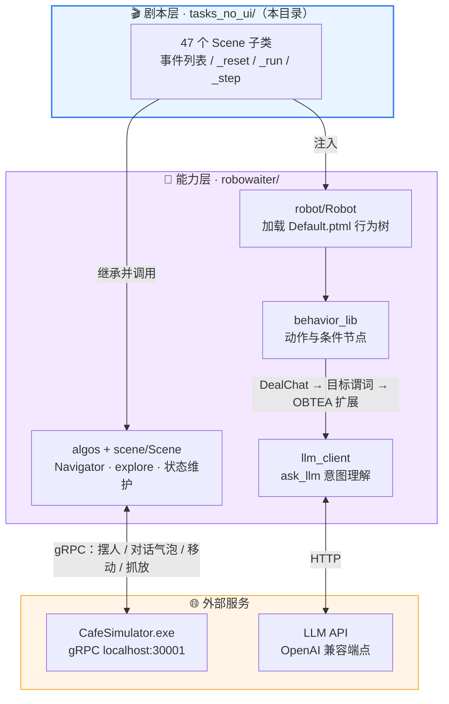
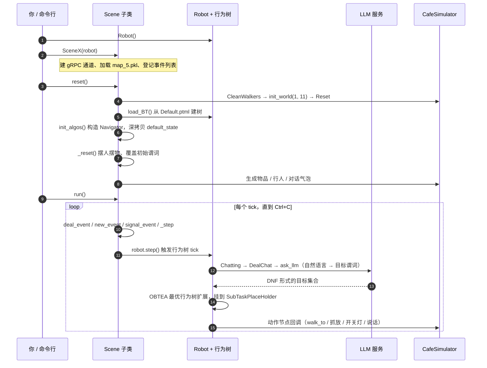
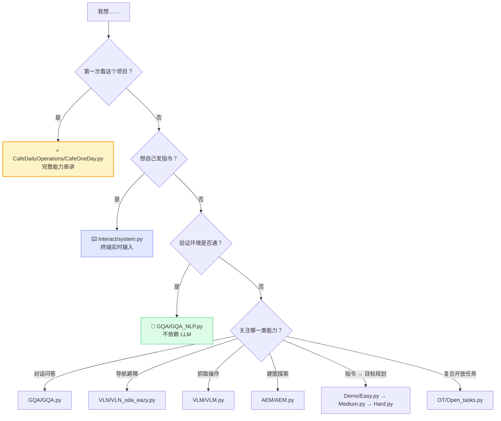
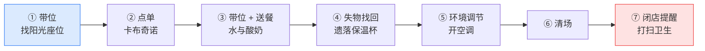

# tasks_no_ui/ — 无 UI 场景任务集

> **一句话定位**：这里每个 `.py` 文件都是一个**可直接运行的咖啡厅场景剧本** —— 不启动界面，直接通过 gRPC 驱动仿真器，让机器人在 `robowaiter/` 的「行为树 + 大模型」链路里完成一件具体任务。

<div align="center">



[](../requirements.txt)
[](#21-目录速查)
[](#21-目录速查)
[](#0-一页速览)
[](#14-运行前置条件)

<p>
  <a href="#0-一页速览">⚡ 速览</a> ·
  <a href="#1-总览它在系统里的位置">🧭 总览</a> ·
  <a href="#2-任务地图">🗺️ 任务地图</a> ·
  <a href="#3-分述各任务族">📖 分述</a> ·
  <a href="#4-写一个自己的场景">🛠️ 扩展</a> ·
  <a href="#5-注意事项与已知坑">⚠️ 避坑</a>
</p>

</div>

---

## 目录

- [0. 一页速览](#0-一页速览)
- [1. 总览：它在系统里的位置](#1-总览它在系统里的位置)
  - [1.1 分层架构](#11-分层架构)
  - [1.2 一个文件 = 一个场景剧本](#12-一个文件--一个场景剧本)
  - [1.3 从命令行到机器人动起来](#13-从命令行到机器人动起来)
  - [1.4 运行前置条件](#14-运行前置条件)
- [2. 任务地图](#2-任务地图)
  - [2.1 目录速查](#21-目录速查)
  - [2.2 我该跑哪一个](#22-我该跑哪一个)
- [3. 分述：各任务族](#3-分述各任务族)
  - [3.1 六类核心任务](#31-六类核心任务)
  - [3.2 综合展示 CafeDailyOperations](#32-综合展示-cafedailyoperations)
  - [3.3 交互与调试 Interact / BtTest](#33-交互与调试-interact--bttest)
  - [3.4 演示集与历史快照 Demo / DemoTest](#34-演示集与历史快照-demo--demotest)
- [4. 写一个自己的场景](#4-写一个自己的场景)
- [5. 注意事项与已知坑](#5-注意事项与已知坑)
- [6. 相关链接](#6-相关链接)

---

## 0. 一页速览

| 维度 | 说明 |
|:---|:---|
| **它是什么** | 系统主程序的**无界面运行入口**；场景定义（事件剧本、行人摆位、初始谓词）与启动代码放在同一个文件里 |
| **规模** | **12 个子目录 · 47 个可独立运行脚本 · 9 个空 `__init__.py`**；47 个脚本全部带 `if __name__ == '__main__':` |
| **统一范式** | `Robot()` → `Scene 子类(robot)` → `reset()` → `run()`，无一例外 |
| **依赖** | `robowaiter/` 包 + CafeSimulator（`localhost:30001`）+ LLM 服务（唯一例外：`GQA/GQA_NLP.py`） |
| **no_ui 的含义** | `Scene.__init__` 里固定 `show_ui = False`、`take_picture = False`（`robowaiter/scene/scene.py:298-302`）；需要界面请改用根目录的 `run_ui.py` |
| **它不是什么** | ❌ 不是可 import 的库（脚本间零互相引用）<br>❌ 不是论文复现代码（那是 [`repro/`](../repro/README.md)）<br>❌ 不含安装说明、模型部署与引用信息（见[根 README](../README.md)） |

**三步跑起来**（工作目录 = 仓库根目录）：

```bash
# 0. 先下载并启动 CafeSimulator.exe，保持运行（gRPC localhost:30001）
pip install -e .
python tasks_no_ui/GQA/GQA.py
```

> [!IMPORTANT]
> `run()` 是 `while True` 的无限循环，**脚本不会自动退出**，观察完后用 `Ctrl+C` 结束。
> 首次运行请先确认 [§1.4 前置条件](#14-运行前置条件) 全部满足，尤其是仿真器与 LLM API 地址。

---

## 1. 总览：它在系统里的位置

### 1.1 分层架构

整个系统分四层，`tasks_no_ui/` 只负责最上面的「剧本层」，所有能力都向下复用 `robowaiter/`：



> 目录内**没有任何脚本 import 另一个脚本**（47 个文件互不引用），复用全部发生在 `robowaiter/` 包层面：
> `Scene` 47/47、`Robot` 47/47、`Bahavior` 11/47（Demo 系列）、`get_root_path` 7/47。
> 这也解释了为什么会有大量同构文件 —— 它们是「复制模板 + 改事件列表」演化的产物。

### 1.2 一个文件 = 一个场景剧本

所有脚本都是下面这个骨架（以 `GQA/GQA.py` 为例，仅保留结构）：

```python
from robowaiter.scene.scene import Scene

class SceneGQA(Scene):
    def __init__(self, robot):
        super().__init__(robot)
        self.new_event_list = [
            (3, self.customer_say, ("System", "哪里有蛋糕"))   # ① 编排剧情
        ]

    def _reset(self):    # ② 摆人摆物、覆盖 condition_set 初始谓词
        pass
    def _run(self):      # ③ 可选的进入主循环前动作（多数为空）
        pass
    def _step(self):     # ④ 可选的每 tick 钩子（仅 Interact / 跟随逻辑用）
        pass

if __name__ == '__main__':
    from robowaiter.robot.robot import Robot
    robot = Robot()
    task = SceneGQA(robot)
    task.reset()
    task.run()
```

| 可覆盖点 | 作用 | 典型用法 |
|:---|:---|:---|
| `event_list` / `new_event_list` / `signal_event_list` | 事件剧本 | `customer_say`、`add_walker`、`control_walker` |
| `_reset()` | 场景初始化 | `gen_obj()` / `gen_obj_tmp()`、摆行人、设定 `condition_set` |
| `_run()` | 主循环前执行一次 | AEM 建图循环、VLM 抓放测试 |
| `_step()` | 每个 tick 执行 | `Interact/system.py` 的 `input()`、行人跟随 |

### 1.3 从命令行到机器人动起来



### 1.4 运行前置条件

| # | 检查项 | 依据 | 缺失后果 |
|:--:|:---|:---|:---|
| 1 | **CafeSimulator.exe 已启动并保持运行** | `scene.py:33-39` 连接 `localhost:30001` | gRPC 连接失败 |
| 2 | `pip install -e .` 已完成 | 全部脚本 `from robowaiter...` | `ModuleNotFoundError` |
| 3 | **LLM 服务可达** | `Default.ptml` → `DealChat()` → `ask_llm` → `llm_client/single_round.py` 中的硬编码地址 | 顾客说话后机器人无响应；改地址见[根 README §2.4](../README.md#️-2-项目安装) |
| 4 | 按任务可选的依赖 | Graphviz / faiss / spaCy 模型，见[根 README §2.3](../README.md#️-2-项目安装) | 绘图、检索或 NLP 环节报错 |
| 5 | **从仓库根目录运行** | 根 README §3.2 的相对路径写法 | 部分脚本（尤其 AEM）路径依赖见[§5](#5-注意事项与已知坑) |

> [!TIP]
> 想先绕开大模型验证通信是否正常？跑 `python tasks_no_ui/GQA/GQA_NLP.py`。
> 它是全目录**唯一**显式指定 `DefaultNLP.ptml` 的脚本，对话走 `DealChatNLP()`，不请求 LLM（`GQA/GQA_NLP.py:38-42`）。

---

## 2. 任务地图

### 2.1 目录速查

| 目录 | 脚本数 | 任务 | 推荐入口 | 状态 |
|:---|:--:|:---|:---|:---|
| `AEM/` | 1 | 主动探索与记忆：构建语义拓扑地图，识别 ≥10 个物品位置 | `AEM.py` | ✅ 核心 |
| `AT/` | 1 | 自主任务：主动发现并执行扫地 / 擦桌 / 摆椅 / 开灯 | `Auto_tasks_light.py` | 🧪 骨架（含 `# todo`） |
| `GQA/` | 3 | 具身多轮对话：点餐与场景问答 | `GQA.py` | ✅ 核心 |
| `VLN/` | 6 | 视觉语言导航：动态避障 ODA 与带位引导 | `VLN_oda_eazy.py` | ✅ 核心 |
| `VLM/` | 8 | 视觉语言操作：17 类原子操作、抓放、点单、空调、闭店 | `VLM.py` | ✅ 核心 |
| `OT/` | 8 | 复杂开放任务：自然语言或谓词目标驱动的复合指令 | `Open_tasks.py` | ✅ 核心 |
| `CafeDailyOperations/` | 7 | 综合展示「咖啡厅的一天」：多顾客长时序串联 | `CafeOneDay.py` | ⭐ 首选演示 |
| `Interact/` | 1 | 命令行自由交互：实时输入指令 | `system.py` | ✅ 实用 |
| `BtTest/` | 1 | 行为树联调场景 | `Open_tasks.py` | 🔧 调试 |
| `Demo/` | 3 | 难度梯度演示集（单意图 → 否定合取 → 析取） | `Easy.py` | ✅ 当前演示集 |
| `DemoTest_0905/` | 4 | 09/05 评测快照 | `Easy.py` | 🗄️ 历史快照 |
| `DemoTest_0915/` | 4 | 09/15 评测快照 | `Easy.py` | 🗄️ 历史快照 |

<details>
<summary>📂 展开完整目录结构</summary>

```text
tasks_no_ui/
├── README.md                  ← 本文件
├── AEM/          AEM.py
├── AT/           Auto_tasks_light.py
├── GQA/          GQA.py · GQA_1_ask_order_place.py · GQA_NLP.py
├── VLN/          VLN_oda_eazy.py · VLN_oda_normal.py · VLN_oda_hard.py
│                 VLN_edge_map.py · VLN_edge_obj.py · VLN_greet_lead.py
├── VLM/          VLM.py · VLM3.py · VLM_1_order.py · VLM_2_AC.py
│                 VLM_AC.py · VLM_order.py · VLM_cafe_shutdown.py · VLN_greet_lead.py
├── OT/           Open_tasks.py · OT_coffee_water_dessert.py · Open_tasks_0106*.py (3)
│                 Open_tasks_bright_table.py · Open_tasks_test.py · Open_tasks_walkers.py
├── CafeDailyOperations/  CafeOneDay.py · CafeOneDay_en.py · CafeOneDay_1128.py
│                 VLN_all.py · VLN_greet_and_order.py
│                 VLN_greet_and_order_1118.py · VLN_greet_and_order_1119.py
├── Interact/     system.py
├── BtTest/       Open_tasks.py
├── Demo/             Easy.py · Medium.py · Hard.py
├── DemoTest_0905/    Easy.py · Medium.py · Hard.py · dessert.py
└── DemoTest_0915/    Easy.py · Medium.py · Hard.py · dessert.py
```

> 9 个 `__init__.py`（本目录根 1 个 + 子目录 8 个）均为空文件；`BtTest/`、`Demo/`、`DemoTest_0905/`、`DemoTest_0915/` 没有。但 47 个脚本都按「直接执行」使用，不依赖包导入。

</details>

### 2.2 我该跑哪一个



---

## 3. 分述：各任务族

### 3.1 六类核心任务

#### 3.1.1 AEM · 主动探索与记忆

目标是「生成环境的语义拓扑地图，并识别记忆不少于 10 个环境物品的位置」（`AEM/AEM.py:1-4`）。实现上用 DBSCAN 聚类障碍、`explore()` / `navigation_move()` 循环建图，matplotlib 实时显示，最终把 `id / name / location / height` 写入 `objs.json`。

```bash
cd tasks_no_ui/AEM && python AEM.py
```

> [!WARNING]
> 该脚本用**相对路径**读写 `../../robowaiter/proto/map_1.pkl` 与 `objs.json`（`AEM.py:43,120`），必须在 `tasks_no_ui/AEM/` 作为工作目录运行，且需先 `pip install -e .` 保证 `robowaiter` 可导入。`os` 也只在 `__main__` 内导入，被 import 后调用会 `NameError`。

#### 3.1.2 AT · 自主任务

`Auto_tasks_light.py` 定义四类主动发现任务（扫地 / 擦桌 / 摆椅 / 开灯），当前通过 `signal_event_list` 触发顾客说「可以关筒灯和关窗帘吗？」。文件里留有 `# todo: 通过行为树控制自动任务`，属于**待扩展骨架**而非完整实现。

#### 3.1.3 GQA · 具身多轮对话

开始条件是顾客 NPC 发出点餐指令，结束条件是顾客表示不再需要服务（`GQA/GQA.py:1-7`）。

| 脚本 | 内容 |
|:---|:---|
| `GQA.py` | 最小样例：System 问「哪里有蛋糕」 |
| `GQA_1_ask_order_place.py` | 完整压测：两位顾客在 5s / 8s / 15s 两轮共 20+ 条问句（好吃推荐、阴凉座位、洗手间、下棋、电影院），并精确控制 7 个行人 |
| `GQA_NLP.py` | 同场景，改用 `DefaultNLP.ptml`，**不调用大模型** |

#### 3.1.4 VLN · 视觉语言导航

主要用于测试导航算法的**动态避障（ODA）**能力：先 `walk_to` 设定起点、`clean_walker` / `add_walkers` 布置动态行人，再 `navigator.navigate(goal, animation=...)`。

| 脚本 | 起点 | 目标 | 特点 |
|:---|:---|:---|:---|
| `VLN_oda_eazy.py` | `(-60, 0)` | `(40, 900)` | 2 个行人 |
| `VLN_oda_normal.py` | `(20, 20)` | `(230, 1200)` | 4 个行人横向移动 |
| `VLN_oda_hard.py` | `(-20, -220)` | `(230, 1200)` | 多段路径 + 占据目标点的行人 |
| `VLN_edge_map.py` | — | `(10000, 10000)` | 越界目标，带 `animation=True` 可视化 |
| `VLN_edge_obj.py` | — | `(-200, 520)` | 边界目标，`animation=True` |
| `VLN_greet_lead.py` | — | — | 带位引导对话「哪里有空位 / 想坐高凳子 / 你带我去吧」 |

> `VLN_oda_eazy.py:41-47` 的注释保留了一份关键常量表（角 1 `[480,1300,90]`、窗 1–5、角 2 `[250,-240,-65]`），复现 ODA 实验时可直接取用。

#### 3.1.5 VLM · 视觉语言操作

覆盖 17 类原子操作（`VLM/VLM.py:78-83`）：制作咖啡、倒水、夹点心、拖地、擦桌子、开关筒灯 / 大厅灯 / 窗帘、调整空调开关与温度、抓握物体、放置物体。`VLM.py` 的 `_run()` 直接实跑 16 号抓握与 17 号放置，是该族最完整的参考实现。

| 脚本 | 场景 |
|:---|:---|
| `VLM.py` | 操作能力主测试：完整 `condition_set` + 6 个行人 + 抓放流程，含操作编号表与真实坐标表（`:78-98`） |
| `VLM3.py` | 带位 + 行人跟随演示 |
| `VLM_1_order.py` / `VLM_order.py` | 点单短版 / 长版 |
| `VLM_2_AC.py` / `VLM_AC.py` | 空调降温短版 / 长版 |
| `VLM_cafe_shutdown.py` | 闭店：员工提醒打扫，预设桌脏 / 地脏 / 椅子脏 / 灯 / 窗帘 / 空调 |
| `VLN_greet_lead.py` | 带位跟随（文件名带 VLN，类名实际是 `SceneVLM`） |

常用坐标（来自 `VLM.py:93-98`）：原始吧台 `[247, 520, 100]`、空调开关旁吧台 `[240, 40, 100]`、水杯桌 `[-70, 500, 107]`、桌子 1 `[-55, 0, 107]`、抹布桌 `[340, 900, 99]`。

#### 3.1.6 OT · 复杂开放任务

设计点单规则 → 构造订单 → 由大模型输出备餐计划 → 在仿真中执行（`OT/Open_tasks.py:1-8`）。目标既可以给自然语言（`customer_say`），也可以直接给一阶谓词目标状态（`set_goal("On(Dessert,Bar)")`）。

| 脚本 | 说明 |
|:---|:---|
| `Open_tasks.py` | 最简：「我有点热，能开个空调吗？」 |
| `OT_coffee_water_dessert.py` | 双顾客咖啡 / 水 / 点心点单 |
| `Open_tasks_bright_table.py` | 唯一用 `set_goal()` 直接下目标状态的脚本 |
| `Open_tasks_0106.py` / `_2.py` / `_3.py` | 01/06 英文版快照：带位 + 点单、寻找遗落保温杯、开空调 + 拖地 |
| `Open_tasks_test.py` | 问卷 / 测试脚本，注释里保留 30+ 条中文 GQA 式问句 |
| `Open_tasks_walkers.py` | 行人展示调试：一次生成 20 个行人 |

### 3.2 综合展示 `CafeDailyOperations`

「咖啡厅的一天」把多个任务串成一条长时序剧情，是**演示与录制视频的首选**。完整流程（`CafeOneDay.py` 的 `signal_event_list`）：



| 脚本 | 用途 |
|:---|:---|
| `CafeOneDay.py` | ⭐ 中文完整版，`scene_flag=1`，串联场景 1–8，`_step()` 实现行人跟随 |
| `CafeOneDay_en.py` | 英文版（`scene_flag=2`） |
| `CafeOneDay_1128.py` | 11/28 快照：同结构，调整了各事件的时间间隔 |
| `VLN_greet_and_order.py` | 保留场景 1–8 完整注释蓝图，只激活「点单 + 带位」片段 |
| `VLN_greet_and_order_1118.py` / `_1119.py` | 11/18、11/19 快照：分别只保留场景 3 / 场景 4 |
| `VLN_all.py` | 名义 all，实际场景 1–7 全被注释，只剩清场 + 闭店收尾 |

> [!NOTE]
> 该目录 7 个文件的类名都是 `SceneVLM`、docstring 都写「视觉语言操作…调节空调」，是从 VLM 脚本复制后未改的历史遗留；`OT/OT_coffee_water_dessert.py`、`VLM/VLN_greet_lead.py` 也有同类现象。**按文件名和事件列表判断任务，不要按类名判断。**

### 3.3 交互与调试 `Interact` / `BtTest`

**`Interact/system.py`** 是最自由的入口：每次机器人空闲时 `input("请输入指令：")`；输入以 `)` 结尾被当成目标状态（走 `new_set_goal`），否则当成顾客对话（走 `customer_say`）。

```bash
python tasks_no_ui/Interact/system.py
# 请输入指令：On(Coffee,Table1)      ← 直接下目标状态
# 请输入指令：给我来杯咖啡            ← 自然语言，交给 LLM 解析
```

**`BtTest/Open_tasks.py`** 是行为树联调场景，注释里保留了「打开空调并降低空调温度」等大量候选指令，适合改一行就试一个目标。

### 3.4 演示集与历史快照 `Demo` / `DemoTest`

`Demo/` 是当前维护的**难度梯度**演示集，用于展示 LLM 把自然语言翻译成目标状态的能力：

| 难度 | 指令 | 语言难点 |
|:---|:---|:---|
| `Easy.py` | *It's quite toasty inside, could you please lower the air conditioning temperature?* | 单意图 |
| `Medium.py` | *Could you please not put the carton drink on table one and close the curtain?* | 否定 + 合取 |
| `Hard.py` | *Could you please turn on the coffee machine at the bar, and make sure the floor is clean or the tube light is off?* | 析取 + 隐含条件 |

`DemoTest_0905/` 与 `DemoTest_0915/` 是按日期保存的**评测快照**，同名文件指令并不相同，不要混用：

| 脚本 | `DemoTest_0905/` | `DemoTest_0915/` |
|:---|:---|:---|
| `Easy.py` | *Turn on the hall light.* | *Please wipe table 1 and bring a yogurt.* |
| `Medium.py` | *One NFC Juice, table 3.* | *I'm at table three, please bring yogurt. If there's no yogurt, coffee is fine.* |
| `Hard.py` | *If there's no yogurt, coffee is fine.* | *Please turn on the hall light, find my thermos, and grab me a piece of bread.* |
| `dessert.py` | *dessert.* | *dessert.*（单指令回归用例） |

> 三个 Demo 目录都通过 `Bahavior.all_object / all_place / tables_for_placement / tables_for_guiding` 显式构造 `default_state["condition_set"]`。`Bahavior` 是项目内 `behavior_lib/_base/Behavior.py` 的既有拼写，**不是**本目录写错。

---

## 4. 写一个自己的场景

复制 `GQA/GQA.py` 作为模板，改三处即可。核心是理解**三种事件列表语义不同，混用会导致事件不触发**（`robowaiter/scene/scene.py:490-522`）：

| 列表 | 元组格式 | 时间语义 | 适用场景 |
|:---|:---|:---|:---|
| `event_list` | `(t, func)` | **绝对**时间（秒），函数无参 | 配合 `create_chat_event("...")` |
| `new_event_list` | `(t, func, args)` | **绝对**时间（秒） | 「第 3 秒顾客说话」 |
| `signal_event_list` | `(t, func, args)` | **相对**上一事件的间隔；`t < 0` 表示等机器人空闲 | 长剧情串联（CafeOneDay 用这个） |

常用 `Scene` API 速查：

| 类别 | 方法 |
|:---|:---|
| 剧情 | `customer_say` · `create_chat_event` · `chat_bubble` · `walker_bubble` |
| 行人 | `add_walker` · `add_walkers` · `control_walker` · `control_walkers_and_say` · `clean_walker(s)` · `remove_walkers` |
| 场景 | `gen_obj` · `gen_obj_tmp` · `set_goal` · `new_set_goal` |
| 导航 / 操作 | `walk_to` · `navigator.navigate` · `move_task_area` · `op_task_execute` |

```python
from robowaiter.scene.scene import Scene

class SceneMyTask(Scene):
    def __init__(self, robot):
        super().__init__(robot)
        self.new_event_list = [
            (3, self.customer_say, ("System", "请给我来杯咖啡")),
        ]
    def _reset(self):
        self.gen_obj_tmp()
    def _run(self):
        pass

if __name__ == '__main__':
    from robowaiter.robot.robot import Robot
    task = SceneMyTask(Robot())
    task.reset()
    task.run()
```

> [!TIP]
> 要换行为树，给 `Robot` 传 `ptml_path` 即可，写法见 `GQA/GQA_NLP.py:38-42`：
> ```python
> from robowaiter.utils.basic import get_root_path
> ptml_path = os.path.join(get_root_path(), 'robowaiter/robot/DefaultNLP.ptml')
> robot = Robot(ptml_path=ptml_path)
> ```

---

## 5. 注意事项与已知坑

1. **不会自己停**：`Scene.run()` 是 `while True`（`scene.py:471-476`），所有脚本都会一直 tick，需 `Ctrl+C`。
2. **多数逻辑在初始化里**：大量脚本的 `_run()` / `_step()` 是 `pass`，任务全写在 `__init__` 的事件列表和 `_reset()` 中 —— 想改剧情别去翻主循环。
3. **事件列表别混用**：三种时间语义见 [§4](#4-写一个自己的场景)，这是「改了没反应」的头号原因。
4. **AEM 的路径与导入**：相对路径 + `os` 只在 `__main__` 导入，见 [§3.1.1](#311-aem--主动探索与记忆)。
5. **LLM 地址是硬编码的**：`robowaiter/llm_client/single_round.py` 里写死了测试端点，换自己 / 本地的 OpenAI 兼容服务前必须改，见[根 README §2.4](../README.md#️-2-项目安装)。
6. **历史复制遗留**：类名 / docstring 与文件名不一致、`Bahavior` 拼写、行尾 `\` 续行、`as file:D` 笔误、`"wd！"` 调试残留，以及注释里未导入的 `GrabSim_pb2` / `sim_client` —— 均为历史遗留，取消注释前请先补齐 import。
7. **待办未完成**：目录内约 28 处 `# todo`，集中在「接收点单信息，大模型生成任务规划」「使用大模型进行对话并适时结束」「通过行为树控制自动任务」。
8. **运行会产生文件**：`Scene.__init__` 会创建 `robowaiter/scene/outputs/`（`scene.py:204,296`）。
9. **学术引用不在这里**：本目录 `.py` 内没有任何论文引用，BibTeX 与项目背景统一见[根 README §6](../README.md#-6-引用)。

---

## 6. 相关链接

| 想了解 | 去哪里 |
|:---|:---|
| 安装、仿真器下载、UI 依赖、模型部署 | [根 README §2–§3](../README.md#️-2-项目安装) |
| 启动带界面版本 | [根 `run_ui.py`](../run_ui.py) |
| 代码框架总览与任务缩写表 | [根 README §4](../README.md#-4-代码框架) |
| 论文复现实验存档 | [`repro/README.md`](../repro/README.md) |
| `Scene` 基类与三种事件调度 | [`robowaiter/scene/scene.py`](../robowaiter/scene/scene.py) |
| 行为树加载与 `SubTaskPlaceHolder` | [`robowaiter/robot/robot.py`](../robowaiter/robot/robot.py) |
| 导航算法与代价地图 | [`robowaiter/algos/navigator/readme.md`](../robowaiter/algos/navigator/readme.md) |

---

<div align="center">

[⬆ 回到顶部](#tasks_no_ui--无-ui-场景任务集) · [🏠 项目首页](../README.md)

</div>
